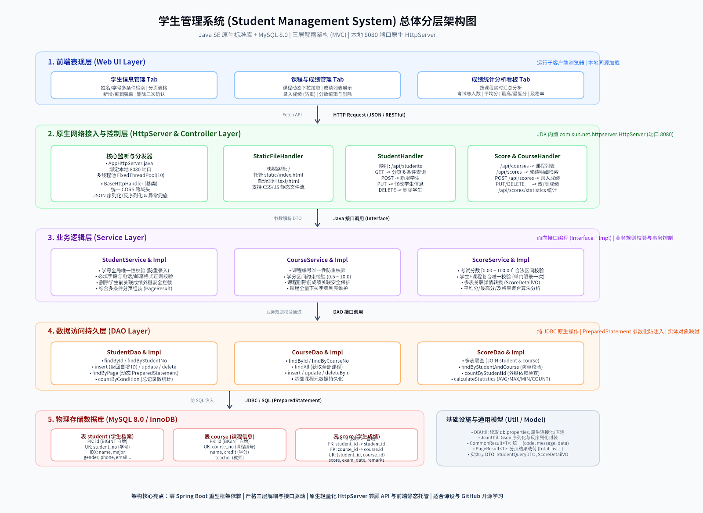
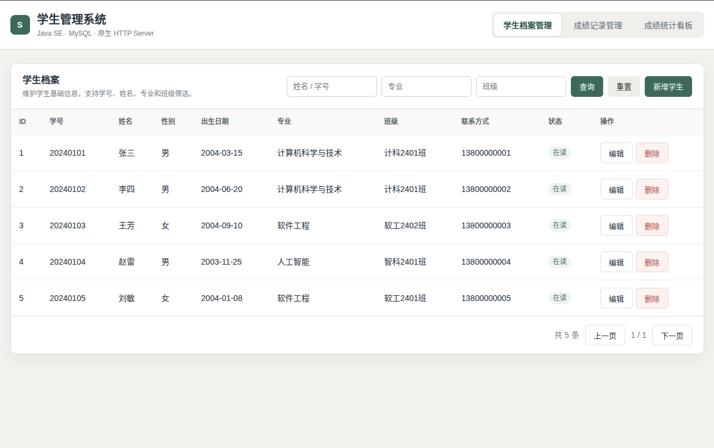
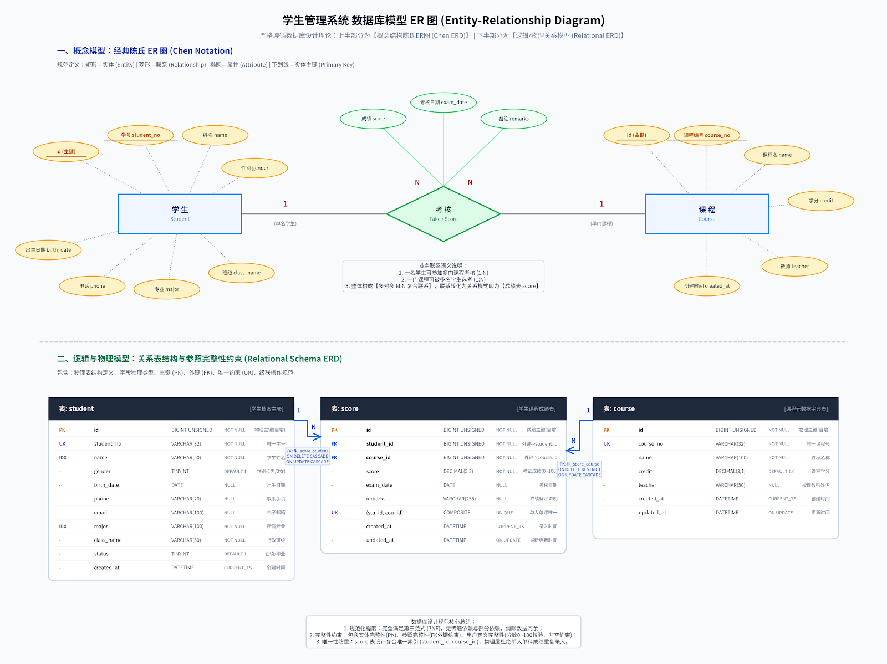

# 学生管理系统（Student Management System）

> 一个基于 **Java SE + MySQL** 的轻量级学生与成绩管理系统。
> 不使用 Spring 全家桶，纯原生 JDK `HttpServer` + JDBC + Gson 实现，**零重型框架依赖**，非常适合用来熟悉分层架构、RESTful 接口与完整开发流程。

<p align="center">
  
</p>

---

## 一、项目简介

本项目是一个用于**学习与实践**的后端小项目，覆盖了从建库建表、DAO/Service/Controller 分层、RESTful 接口设计，到静态前端页面托管与端到端联调的完整链路。

> 🎓 **适用场景**：本项目可直接用于**大学生 Java 课程设计 / 数据库课程设计 / 软件工程课程实训**。
> 需求完整、分层清晰、注释详尽，配套数据库建表脚本与 ER 图，既能直接演示，也方便在此基础上二次开发并撰写课程设计报告。

系统包含三大功能模块：

| 模块 | 说明 |
| :--- | :--- |
| **学生信息管理** | 学生档案的增删改查、按姓名/学号/专业/班级多条件分页检索 |
| **成绩记录管理** | 成绩录入、修改、删除，多表联查（学生 + 课程）分页明细 |
| **成绩统计分析** | 按课程或全校统计参考人数、平均分、最高/最低分、及格率 |

---

## 二、技术选型

| 层次 | 技术 |
| :--- | :--- |
| 语言 / 构建 | Java 21、Maven |
| Web 容器 | JDK 内置 `com.sun.net.httpserver.HttpServer`（默认 8080 端口） |
| 数据库 | MySQL 8.0+ / InnoDB / utf8mb4 |
| 数据访问 | 原生 JDBC + `PreparedStatement` 预编译防注入 |
| JSON 处理 | Google Gson 2.10.1 |
| 前端 | 单文件 HTML5 + 原生 CSS + 原生 JavaScript（Fetch API），页面内自包含、无 CDN 依赖 |
| 测试 | JUnit 5 自动化单元测试（不依赖数据库）+ 可选的真实数据库集成测试 |

---

## 三、项目结构

```
student-management-system
├── pom.xml                                  # Maven 依赖与编译配置
├── README.md
├── sql
│   ├── schema.sql                           # 建库建表脚本
│   └── data.sql                             # 初始测试数据
└── src
    ├── main
    │   ├── java/com/sms
    │   │   ├── Main.java                    # 程序统一启动入口
    │   │   ├── server/AppHttpServer.java     # HttpServer 创建、线程池、路由注册
    │   │   ├── controller/                   # 控制层：HTTP 路由与参数解析
    │   │   │   ├── BaseHttpHandler.java      # 通用基类：CORS、异常、Query/JSON 处理
    │   │   │   ├── StudentHandler.java
    │   │   │   ├── CourseHandler.java
    │   │   │   ├── ScoreHandler.java
    │   │   │   └── StaticFileHandler.java    # classpath:static 静态资源托管
    │   │   ├── service/                      # 业务层：接口 + impl 实现、业务校验
    │   │   ├── dao/                          # 持久层：接口 + impl JDBC 实现
    │   │   ├── exception/                    # 业务异常：BusinessException / Conflict(409) / NotFound(404)
    │   │   ├── model                        # 实体 / DTO / VO
    │   │   │   ├── entity/                   # Student、Course、Score
    │   │   │   ├── dto/                      # StudentQueryDTO、ScoreQueryDTO
    │   │   │   └── vo/                       # CommonResult、PageResult、ScoreDetailVO...
    │   │   └── util                          # DBUtil、JsonUtil、PageUtil
    │   └── resources
    │       ├── db.properties.example         # 数据库连接配置模板（提交进仓库）
    │       ├── db.properties                 # 本地实际配置（已 gitignore，不会入库）
    │       └── static/                       # 单文件前端页面 + 架构图 / ER 图 / 截图
    └── test/java/com/sms
        ├── support/InMemoryDaos.java          # 内存版 DAO 桩对象（测试用，无需数据库）
        ├── *Test.java                         # JUnit 5 自动化单元测试
        └── *HandlerTest / *DaoImplTest 等      # 需数据库的手工集成测试
```

**分层调用链**：`浏览器 → Handler → Service → DAO → MySQL`，各层只依赖下层接口，便于替换实现与单元测试。

---

## 四、快速开始

### 前置要求

- JDK 21（`pom.xml` 中通过 `<release>21</release>` 统一编译版本）
- Maven 3.6+
- MySQL 8.0+（本机默认 `127.0.0.1:3306`）

### 第 1 步：初始化数据库

在项目根目录执行（会创建 `student_db` 及三张表并写入演示数据）：

```bash
mysql -u root -p < sql/schema.sql
mysql -u root -p < sql/data.sql
```

> `schema.sql` 中包含 `DROP TABLE IF EXISTS`，重复执行会重建表结构，请勿在正式数据上运行。

### 第 2 步：配置数据库连接

项目使用 `src/main/resources/db.properties` 保存数据库账号密码。出于安全考虑，
**该文件已被 `.gitignore` 忽略，不会提交到 Git 仓库**，仓库里只提供模板 `db.properties.example`。

先复制模板，再填写你自己的账号密码：

```bash
# Linux / macOS
cp src/main/resources/db.properties.example src/main/resources/db.properties

# Windows (PowerShell / CMD)
copy src\main\resources\db.properties.example src\main\resources\db.properties
```

然后编辑 `src/main/resources/db.properties`，把 `db.username` / `db.password` 改成你本机 MySQL 的真实值：

```properties
db.driver=com.mysql.cj.jdbc.Driver
db.url=jdbc:mysql://127.0.0.1:3306/student_db?useSSL=false&serverTimezone=Asia/Shanghai&characterEncoding=UTF-8&allowPublicKeyRetrieval=true
db.username=root
db.password=你的MySQL密码
```

> 提示：如果启动时提示「未在 classpath 根路径找到 db.properties 配置文件」，
> 说明第 2 步的复制动作还没做。

### 第 3 步：启动服务

**方式一（推荐）**：在 IDEA 中直接运行 `com.sms.Main` 的 `main` 方法。

**方式二**：命令行启动。

```bash
# 编译
mvn -q clean compile

# 导出运行时依赖 classpath
mvn -q dependency:build-classpath -Dmdep.outputFile=classpath.txt

# 启动（默认 8080 端口）
java -cp "target/classes:$(cat classpath.txt)" com.sms.Main

# 也可以指定端口，例如 9090
java -cp "target/classes:$(cat classpath.txt)" com.sms.Main 9090
```

看到控制台输出即表示启动成功：

```
学生管理系统 HTTP 服务已启动: http://localhost:8080/
学生接口: /api/students
课程接口: /api/courses
成绩接口: /api/scores
前端入口: http://localhost:8080/
```

### 第 4 步：访问系统

浏览器打开 👉 <http://localhost:8080/>，即可看到图形化界面；后端接口根路径为 `http://localhost:8080/api/...`。

---

## 五、界面预览

<p align="center">
  
</p>

---

## 六、接口一览

所有接口统一返回 `code + message + data` 结构：

```json
{
  "code": 200,
  "message": "查询成功",
  "data": { }
}
```

业务状态码语义（HTTP 状态码与 `code` 保持一致）：

| code | 含义 | 典型场景 |
| :--- | :--- | :--- |
| **200** | 成功 | 增删改查正常完成 |
| **400** | 参数错误 | 必填项缺失、分数/学分越界、日期格式错误、路径 ID 非法 |
| **404** | 资源不存在 | 学生/课程/成绩不存在，指定统计的课程不存在 |
| **405** | 方法不允许 | 对静态资源使用 POST，或使用不支持的请求方法 |
| **409** | 业务冲突 | 学号重复、课程编号重复、同一课程重复录入成绩、有关联数据禁止删除 |
| **500** | 服务器内部错误 | 数据库不可用等未预期异常（对外只返回通用文案） |

| 模块 | 方法 | 路径 | 说明 |
| :--- | :--- | :--- | :--- |
| 学生 | GET | `/api/students` | 分页 + 条件检索（`page`、`pageSize`、`keyword`、`major`、`className`、`status`） |
| 学生 | GET | `/api/students/{id}` | 查询学生详情 |
| 学生 | POST | `/api/students` | 新增学生 |
| 学生 | PUT | `/api/students/{id}` | 修改学生基本信息（学号不可改） |
| 学生 | DELETE | `/api/students/{id}` | 删除学生（有成绩时拦截） |
| 课程 | GET | `/api/courses` | 获取全部课程（下拉列表） |
| 课程 | GET | `/api/courses/{id}` | 查询课程详情 |
| 课程 | POST | `/api/courses` | 新增课程 |
| 课程 | PUT | `/api/courses/{id}` | 修改课程 |
| 课程 | DELETE | `/api/courses/{id}` | 删除课程（有成绩时拦截） |
| 成绩 | GET | `/api/scores` | 分页多条件查询成绩明细 |
| 成绩 | GET | `/api/scores/{id}` | 查询单条成绩 |
| 成绩 | POST | `/api/scores` | 录入成绩 |
| 成绩 | PUT | `/api/scores/{id}` | 修改成绩（仅分数/日期/备注） |
| 成绩 | DELETE | `/api/scores/{id}` | 删除成绩 |
| 成绩 | GET | `/api/scores/statistics` | 成绩统计（可传 `courseId` 指定课程） |

**请求示例**

```bash
# 分页检索学生
curl "http://localhost:8080/api/students?page=1&pageSize=10&keyword=张"

# 录入成绩
curl -X POST http://localhost:8080/api/scores \
  -H "Content-Type: application/json" \
  -d '{"studentId":4,"courseId":2,"score":82,"examDate":"2026-06-18","remarks":"期末正考"}'

# 统计某门课程
curl "http://localhost:8080/api/scores/statistics?courseId=1"
```

---

## 七、数据表设计

| 表名 | 说明 | 关键约束 |
| :--- | :--- | :--- |
| `student` | 学生档案 | `student_no` 唯一 |
| `course` | 课程信息 | `course_no` 唯一 |
| `score` | 学生成绩 | `(student_id, course_id)` 复合唯一；外键关联学生与课程 |

业务规则要点：

- 学号、课程编号全局唯一，重复即拦截；
- 同一学生在同一门课程下只能有一条成绩记录；
- 成绩取值范围 `0.00 ~ 100.00`，学分取值范围 `0.5 ~ 10.0`；
- 学生/课程名下有成绩时禁止删除，保护历史数据完整性。

### 数据库 ER 图

下图同时给出**概念模型（Chen 氏 ER 图：实体 / 联系 / 属性）**与**逻辑与物理模型（关系表结构、主键 PK、外键 FK、唯一约束 UK、级联规则）**：

<p align="center">
  
</p>

---

## 八、测试说明

项目包含两类测试：

**1）JUnit 5 自动化单元测试（推荐，零外部依赖）**

不依赖 MySQL，使用内存版 DAO 桩对象验证业务规则与接口行为，直接执行：

```bash
mvn test
```

覆盖内容包括：学生/课程/成绩的业务校验与状态码（400/404/409）、非法日期返回 400、
非法路径 ID 返回 400、静态资源 HEAD 请求、分页参数上限截断等。

**2）真实数据库集成测试（可选）**

`*HandlerTest`、`*DaoImplTest`、`*ServiceImplTest` 等类通过 `main` 方法运行，
需要先完成第 1、2 步（建库 + 配置 `db.properties`），然后在 IDE 中右键运行对应类的 `main` 方法。

> 说明：这些集成测试是为了配合学习流程保留的手工验证脚本，不参与 `mvn test`。

---

## 九、常见问题（FAQ）

**1. 启动报 “HTTP 服务启动失败：Address already in use”？**
8080 端口被占用，换端口启动即可：`java -cp ... com.sms.Main 9090`。

**2. 接口返回 500，提示数据库相关错误？**
检查 MySQL 是否启动、`db.properties` 账号密码是否正确、`student_db` 是否已创建。

**2.1 克隆项目后启动报「未找到 db.properties」？**
克隆下来的仓库只包含模板 `db.properties.example`，需要先复制为 `db.properties` 并填写密码（见「第 2 步」）。

**3. 页面中文乱码？**
确认数据库使用 `utf8mb4`，且 `db.url` 中带有 `characterEncoding=UTF-8`。

**4. 页面能打开但列表为空？**
先确认已执行 `sql/data.sql` 写入演示数据，再确认接口 `/api/students` 是否正常返回。

---

## 十、开源协议

本项目基于 **MIT License** 开源，仅供学习与交流使用。

---

## 十一、后续可优化方向

- 引入连接池（如 HikariCP），避免每次查询都新建物理连接；
- 接入 JWT 登录鉴权与角色权限控制；
- 增加日志框架（SLF4J + Logback）替换 `System.out`，并记录请求耗时；
- 为“多步写操作”补充数据库事务边界管理；
- 增加 Docker Compose，一键拉起 MySQL 与应用。
